<!-- Tay / Across Dimensions — Game Edition. Upload this README.md and the assets folder to TayBoonTao/TayBoonTao. -->

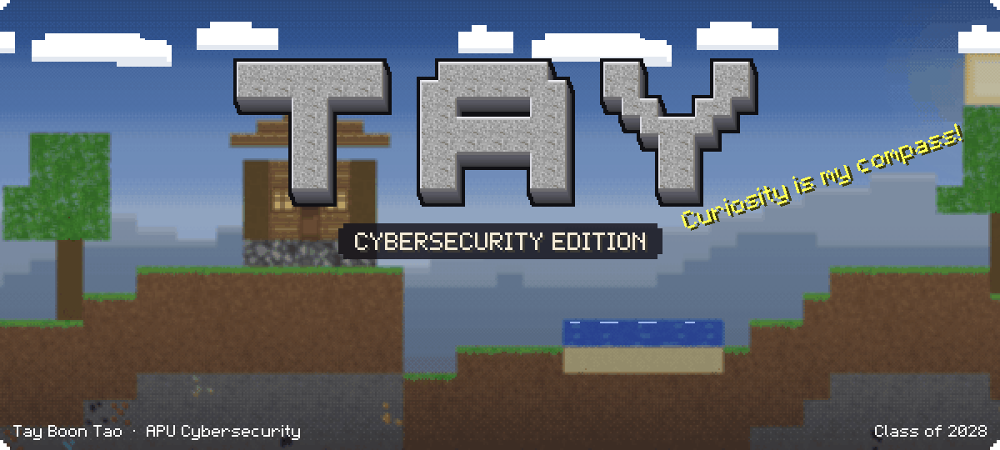

<a href="#overworld--village">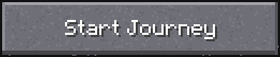</a>
<a href="#the-end--projects">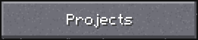</a>
<a href="#multiplayer--contact">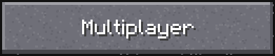</a>

<b>One curious builder. Four worlds to explore.</b> 一个不断探索的建造者，四个等你探索的世界。

## Overworld · Village

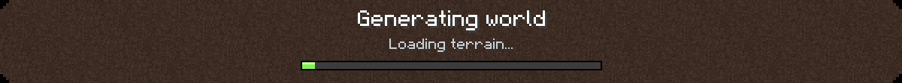

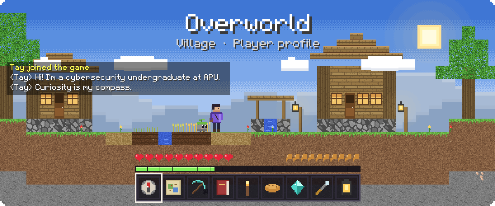

我是一名网络安全本科生，喜欢跨领域研究，通过不断挑战自己，把想法变成实际作品。

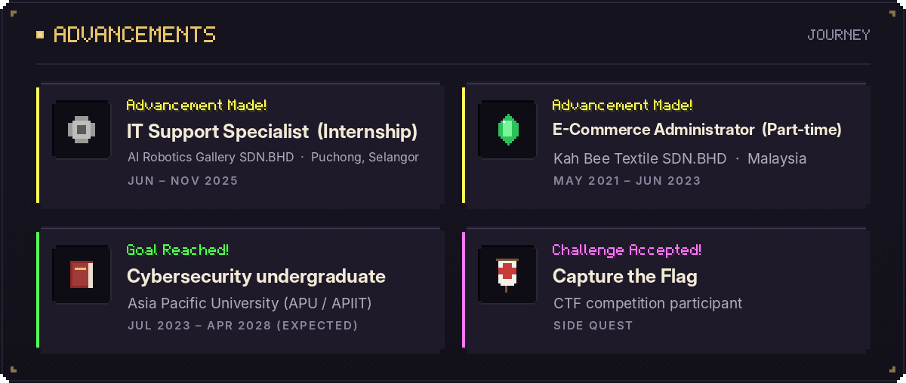

Read player journal / 经历与学历文字版

| Period | Role | Organisation |
| :--- | :--- | :--- |
| Jun–Nov 2025 | Information Technology Support Specialist · Internship | AI Robotics Gallery SDN.BHD |
| May 2021–Jun 2023 | E-Commerce Administrator · Part-time | Kah Bee Textile SDN.BHD |

**Education:** Cybersecurity undergraduate at Asia Pacific University of Technology and Innovation (APU / APIIT). Jul 2023–Apr 2028 (expected).

**Activities:** CTF competition participation and simulated offline cracking practice.

**Languages:** Chinese, English, Malay, Cantonese and basic Hokkien.

## The Caves · Toolkit



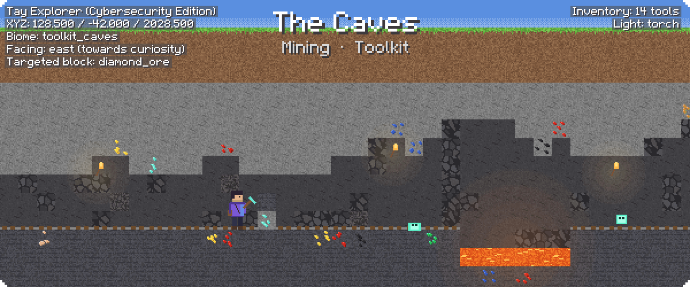

Open inventory / 技能文字版

| Category | Tools and practice |
| :--- | :--- |
| Programming | Python · C# · C++ · Java |
| Linux environments | Kali Linux · Rocky Linux · Ubuntu |
| Security practice | Wireshark · Nmap · simulated offline password-cracking exercises |
| Development | UI design · frontend development · backend development · AI chatbots |

These are tools and areas I have used or practised; no skill ranking is implied.

## The Nether · Security Lab

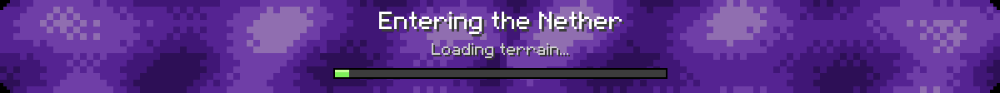

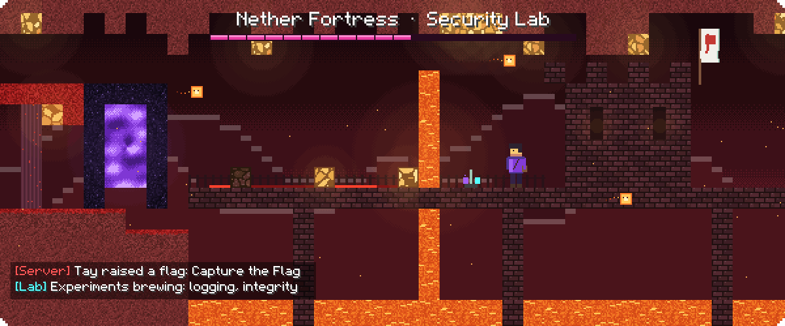

## The End · Projects

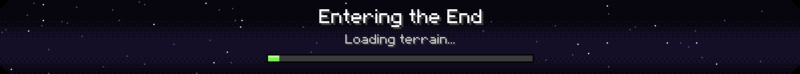

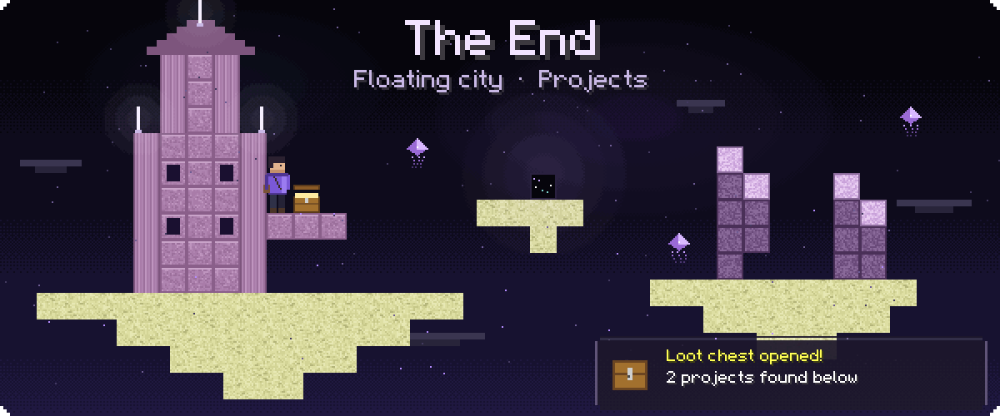

<a href="https://github.com/TayBoonTao/MumCare">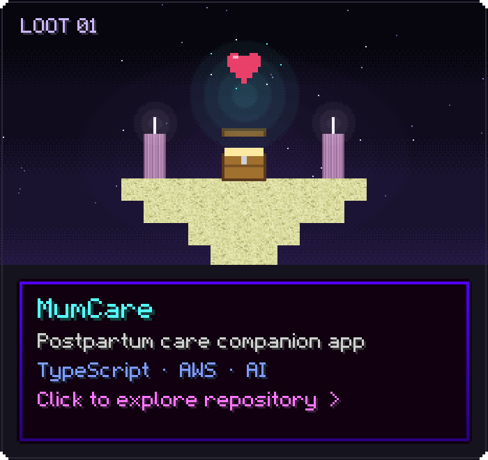</a>
<a href="https://github.com/TayBoonTao/Syntax-Error-Academy">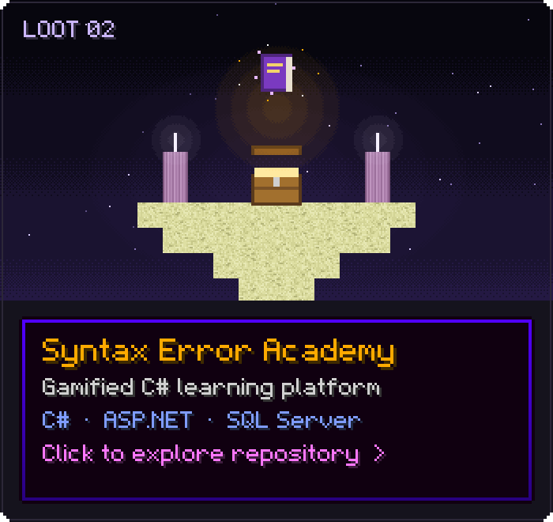</a>

<a href="https://github.com/TayBoonTao/MumCare">Explore MumCare →</a> &nbsp; · &nbsp; <a href="https://github.com/TayBoonTao/Syntax-Error-Academy">Explore Syntax Error Academy →</a>

## Multiplayer · Contact

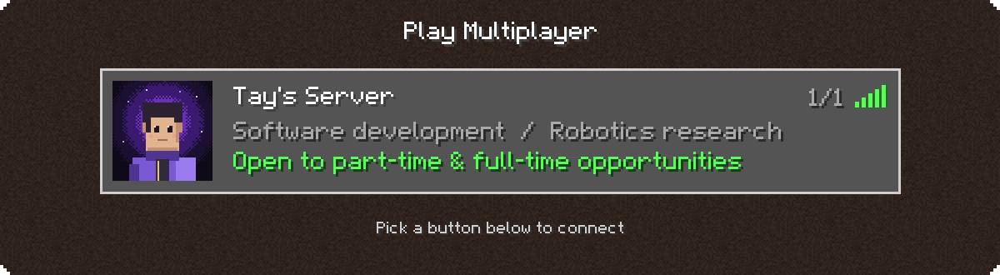

<a href="mailto:boontaotay@gmail.com">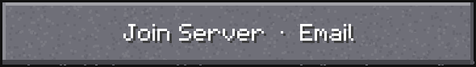</a>
<a href="https://www.linkedin.com/in/boon-tao-tay-91272a364/">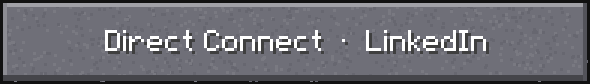</a>

<a href="mailto:boontaotay@gmail.com">boontaotay@gmail.com</a> &nbsp; · &nbsp; <a href="https://www.linkedin.com/in/boon-tao-tay-91272a364/">LinkedIn / Boon Tao Tay</a>

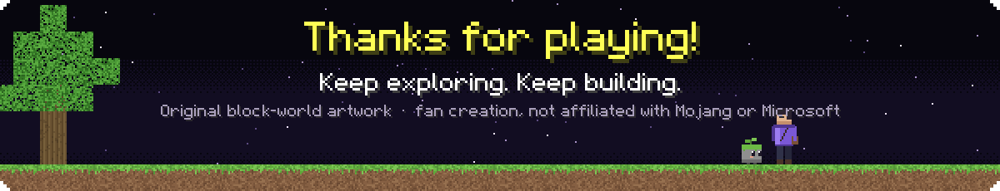

保持好奇，继续建造。 Original block-world artwork for Tay: every texture, item and creature is drawn from scratch. Inspired by Minecraft; an independent fan creation, not affiliated with Mojang or Microsoft.

