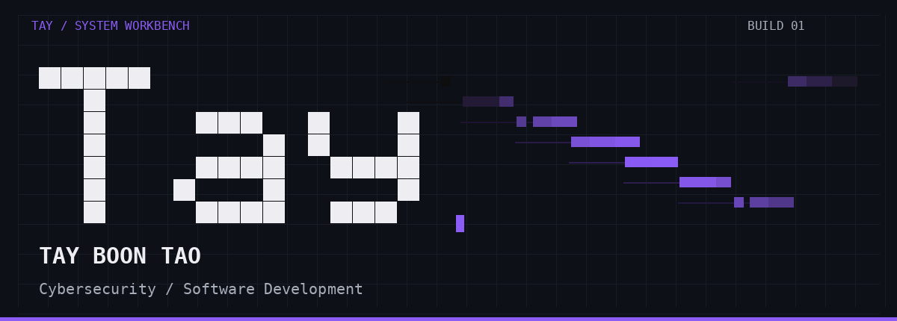
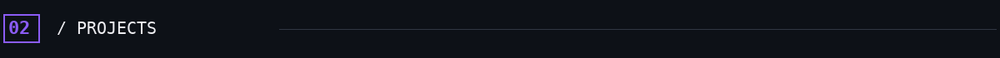
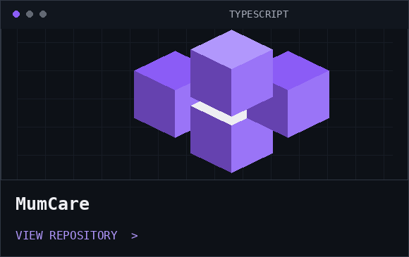
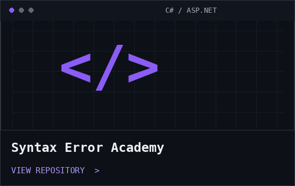
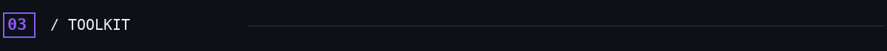
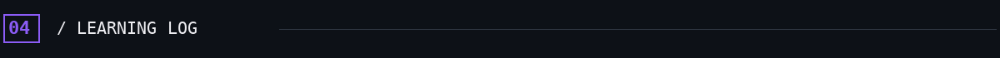
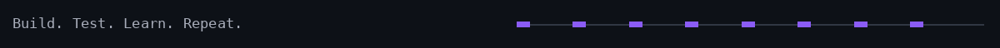

<p align="center"></p>


## Build with curiosity.

I’m **Tay Boon Tao**, a cybersecurity student based in Malaysia, exploring secure systems and practical software development.

我是一名网络安全方向的学生，通过项目实践探索软件开发与系统安全。

```text
$ whoami
TayBoonTao

$ focus
Cybersecurity / Software Development

$ approach
Build. Test. Learn. Repeat.
```



| | |
| :--- | :--- |
| [](https://github.com/TayBoonTao/MumCare) | [](https://github.com/TayBoonTao/Syntax-Error-Academy) |
| **MumCare** · TypeScript | **Syntax Error Academy** · C# / ASP.NET |
| [Explore the repository →](https://github.com/TayBoonTao/MumCare) | [Explore the repository →](https://github.com/TayBoonTao/Syntax-Error-Academy) |



Technologies used across my projects:

**`C#`** &nbsp; **`ASP.NET`** &nbsp; **`TypeScript`** &nbsp; **`Git`** &nbsp; **`GitHub`**



- **Security logging** — exploring audit trails and log integrity.
- **Blockchain integrity verification** — developing the direction for my final-year project.

---


