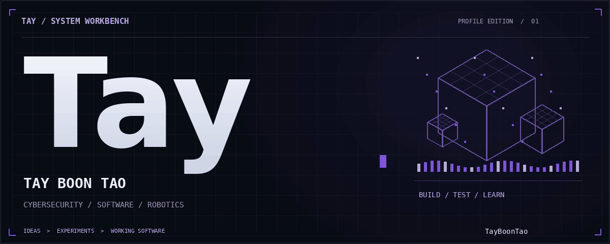
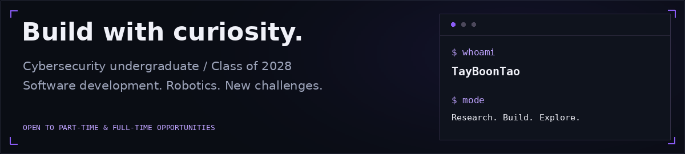
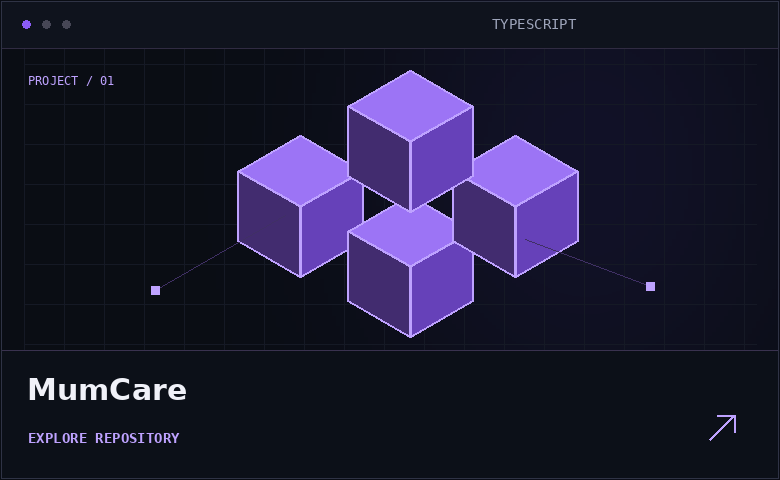
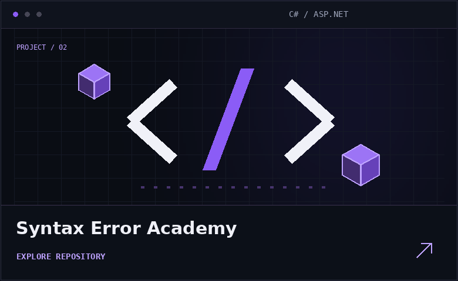
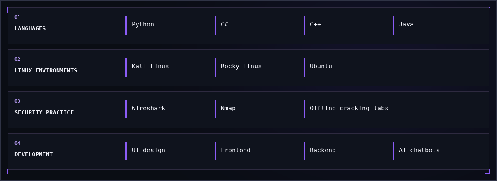
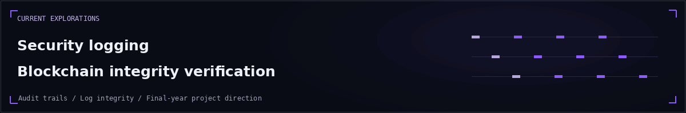
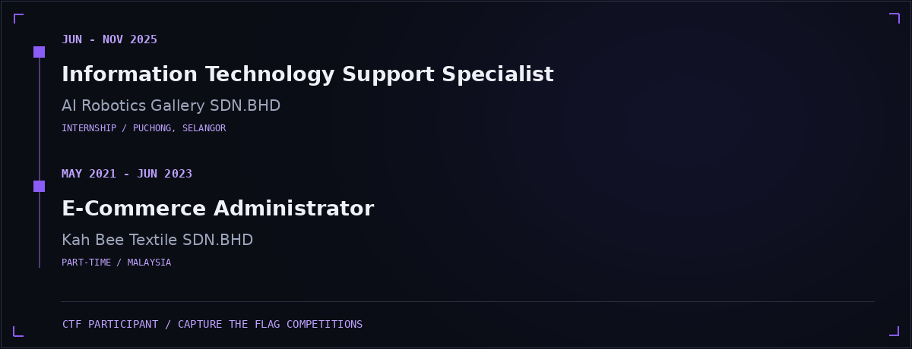
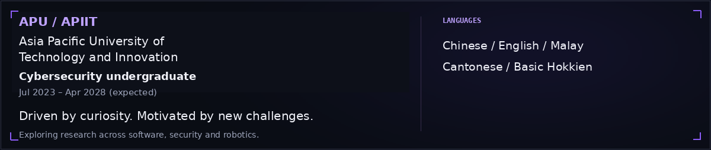
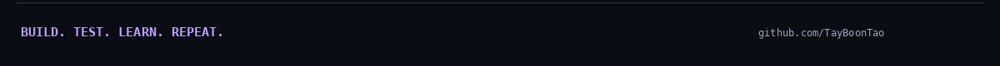

  

我是一名预计于 **2028 年毕业的网络安全本科生**，喜欢跨领域研究，并通过新挑战拓展自己的能力。

**Career interests:** software development and robotics research. Open to **part-time and full-time opportunities**.

**求职方向：** 软件开发、机器人研究相关岗位；关注兼职与全职机会。

<table>
  <tr>
    <td width="50%" valign="top">
      
    </td>
    <td width="50%" valign="top">
      
    </td>
  </tr>
</table>

  <a href="https://github.com/TayBoonTao/MumCare">MumCare →</a>
  &nbsp; · &nbsp;
  <a href="https://github.com/TayBoonTao/Syntax-Error-Academy">Syntax Error Academy →</a>

More about this direction / 研究方向

I’m exploring how security logs can be checked for integrity, with a focus on audit trails and blockchain-based verification as a final-year project direction.

目前关注安全日志的完整性验证、审计记录，以及区块链在日志验证中的应用。

Experience in text / 经历文字版

| Period | Role | Organisation | Type |
| :--- | :--- | :--- | :--- |
| Jun–Nov 2025 | Information Technology Support Specialist | AI Robotics Gallery SDN.BHD | Internship |
| May 2021–Jun 2023 | E-Commerce Administrator | Kah Bee Textile SDN.BHD | Part-time |

**Security activities:** participated in CTF competitions and simulated offline password-cracking exercises.
没有在这里标注未经确认的比赛名次或具体工作职责。

**Asia Pacific University of Technology and Innovation (APU / APIIT)**  
Cybersecurity undergraduate · Jul 2023–Apr 2028 (expected)

### Let’s connect

[Email — boontaotay@gmail.com](mailto:boontaotay@gmail.com) &nbsp; · &nbsp; [LinkedIn — Boon Tao Tay](https://www.linkedin.com/in/boon-tao-tay-91272a364/)

Interested in software development, robotics research and opportunities to learn through challenging work.

